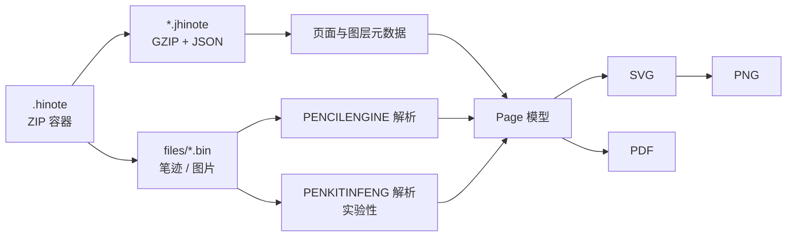

<div align="center">


<h1>Hinoter</h1>

<p>读写华为笔记 <code>.hinote</code> 的小工具：支持浏览器里预览与导出</p>

[](LICENSE)
[](#命令行参考)
[](#支持范围)
[](https://github.com/huwangpeng/Hinoter/stargazers)
[](https://github.com/deepseek-ai/deepseek-harness)

中文 | [English](README_EN.md) | [日本语](README_JP.md)

</div>

## 这是什么

`.hinote` 是华为笔记 App 的私有格式，本项目将其可以解析为无损的SVG和PDF，并且提供网页查看器和Python命令行版本。

## 目录

- [快速开始](#快速开始)
- [命令行参考](#命令行参考)
- [多图层](#多图层)
- [支持范围](#支持范围)
- [解析流程](#解析流程)
- [项目结构](#项目结构)
- [路线图](#路线图)
- [许可](#许可)

## 快速开始

| 想做的事 | 入口 | 还要装什么 |
| --- | --- | --- |
| 预览笔记，导出 SVG / PDF / PNG | [index.html](index.html) | 无 |
| 批量导出 | [src/hinote_vector_export.py](src/hinote_vector_export.py) | Python 3.10+ |
| 导出 PNG | 同上，加 `--ppi` | `cairosvg` |
| PDF 转成笔记 | [src/pdf_to_hinote.py](src/pdf_to_hinote.py) | `pypdf` |

### 1. 网页查看器

打开根目录的 [index.html](index.html)，按笔记类型选查看器：

- [web/hinote-viewer.html](web/hinote-viewer.html)：常规笔记（`PENCILENGINE`）
- [web/infinite-viewer.html](web/infinite-viewer.html)：无边画布（`PENKITINFENG`），实验性

### 2. 命令行导出

```powershell
python src/hinote_vector_export.py "笔记.hinote"
```

结果导出到 `out/笔记/`：报告在同目录下 `report.md` 里。 

Hinoter 也可以一次处理多个文件，示例如下：

```powershell
python src/hinote_vector_export.py "笔记一.hinote" "笔记二.hinote" -o export
```

### 3. 导出 PNG

```powershell
pip install cairosvg
python src/hinote_vector_export.py "笔记.hinote" --ppi 300 --size a4
```

可选依赖：  
嵌入中文文本需要 `fonttools`（系统同时要有可用的中文字体）；  
还原导入的 PDF 背景页需要 `pymupdf`。

```powershell
pip install fonttools pymupdf
```

### 4. PDF 转笔记

[src/pdf_to_hinote.py](src/pdf_to_hinote.py) 把 PDF 装进 `.hinote` 容器，类似华为笔记直接导入 PDF 效果

```powershell
pip install pypdf
python src/pdf_to_hinote.py "资料.pdf" -o "导入用.hinote" --title "项目资料"
```

默认输出在 PDF 同目录、同名 `.hinote`；输出已存在时停止，`--force` 才覆盖。

## 命令行参考

| 参数 | 作用 | 默认 |
| --- | --- | --- |
| `archives...` | 一个或多个 `.hinote` 文件 | 必填 |
| `-o, --output` | 输出根目录 | `out` |
| `--ppi` | 导出 PNG 的像素密度，如 `300` | `0`（不导 PNG） |
| `--size` | 纸张：`a4` / `a3` / `a5` / `letter` / `legal`，或 `宽x高` | `a4` |
| `--split-layers` | 额外按图层各导一张 SVG 到 `svg/layers/` | 关 |
| `--only-layer` | 只导出指定图层，可写图层名或 id，可重复 | 全部 |
| `--hide-layer` | 排除指定图层，可重复 | 无 |
| `--all-layers` | 连笔记里标记为隐藏的图层一起导出 | 跳过隐藏图层 |

## 多图层

从华为笔记 `hinote_1.0.6` 起有页面图层。本工具会自动识别，并把图层信息写进 `report.md`：

```powershell
# 合并导出（默认行为，所有可见图层按自下而上合成）
python src/hinote_vector_export.py "多图层笔记.hinote"

# 额外按图层各导出一张 SVG 到 svg/layers/
python src/hinote_vector_export.py "多图层笔记.hinote" --split-layers

# 按图层名或 id 筛选
python src/hinote_vector_export.py "多图层笔记.hinote" --only-layer "图层 1"
python src/hinote_vector_export.py "多图层笔记.hinote" --hide-layer 0

# 连笔记里被隐藏的图层一起导出
python src/hinote_vector_export.py "多图层笔记.hinote" --all-layers
```

`--hide-layer` / `--only-layer` 都匹配图层名（不分大小写）或 `layerId`，可重复使用。默认跳过笔记自身标记为隐藏的图层；旧版本笔记没有图层信息，行为与以往一致。

笔迹归属靠每个笔画样式记录前的 16 字节图层 UUID 判定，格式细节与判别方法见 [HINOTE_FORMAT.md](docs/HINOTE_FORMAT.md#多图层hinote_106)。

## 支持范围

| 内容 | 有界笔记 `PENCILENGINE` | 无边画布 `PENKITINFENG` |
| --- | :---: | :---: |
| 钢笔 / 荧光笔（可变宽度、透明度） | ✅ | ⚠️ 试验性 |
| 文本、图片 | ✅ | ⚠️ 只还原坐标 |
| 横格 / 方格 / 点阵模板 | ✅ | ❌ |
| 导入的 PDF / 图片页 | ✅ | ❌ |
| 多图层（`hinote_1.0.6`） | ✅ | ❌ |
| 横竖页面混排 | ✅ | ❌ |
| 命令行导出 | ✅ | ❌ |

## 解析流程



## 项目结构

```text
hinoter/
├── index.html                      查看器入口
├── src/
│   ├── hinote_vector_export.py     有界笔记导出（SVG / PDF / PNG）
│   ├── hinote_infinite.py          无边画布解析实验
│   └── pdf_to_hinote.py            PDF 转有界笔记
├── tests/
│   ├── test_layers.py              图层解析、筛选与端到端导出
│   └── test_infinite.py            无边画布解析
├── web/
│   ├── hinote-viewer.html          有界笔记查看器
│   └── infinite-viewer.html        无边画布查看器
├── docs/
│   ├── HINOTE_FORMAT.md            有界笔记格式记录
│   ├── 无界笔记格式分析.md           无边画布格式记录
│   └── images/                     README 截图
└── sample/                         本地样本，不入库
```

## 路线图

- [x] 有界笔记：笔迹、文本、图片、模板、多图层
- [x] 命令行导出 SVG / PDF / PNG
- [x] PDF 转 `.hinote`
- [ ] `PENKITINFENG` 保留字段与笔宽变化
- [ ] 无边画布接入主导出脚本
- [ ] 写回：生成带笔迹的 `.hinote`

## 许可

MIT License，详见 [LICENSE](LICENSE)。

## 致谢

如果这个项目对你有用，欢迎点个 star。

[](https://star-history.com/#huwangpeng/Hinoter&Date)
