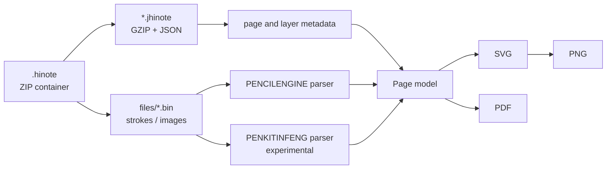

<div align="center">


<h1>Hinoter</h1>

<p>Small tools for reading and writing Huawei Notes <code>.hinote</code> files, with preview and export in the browser.</p>

[](LICENSE)
[](#cli-reference)
[](#what-is-covered)
[](https://github.com/huwangpeng/Hinoter/stargazers)
[](https://github.com/deepseek-ai/deepseek-harness)

[中文](README.md) | English | [日本语](README_JP.md)

</div>

## What this is

`.hinote` is the private format of the Huawei Notes app. This project parses it into lossless SVG and PDF, and ships both a web viewer and a Python command-line version.

## Contents

- [Quick start](#quick-start)
- [CLI reference](#cli-reference)
- [Layers](#layers)
- [What is covered](#what-is-covered)
- [Pipeline](#pipeline)
- [Layout](#layout)
- [Roadmap](#roadmap)
- [License](#license)

## Quick start

| I want to… | Entry point | Extra dependency |
| --- | --- | --- |
| Preview a note, export SVG / PDF / PNG | [index.html](index.html) | none |
| Batch export | [src/hinote_vector_export.py](src/hinote_vector_export.py) | Python 3.10+ |
| Export PNG | same script, plus `--ppi` | `cairosvg` |
| Turn a PDF into a note | [src/pdf_to_hinote.py](src/pdf_to_hinote.py) | `pypdf` |

### 1. Web viewer

Open [index.html](index.html) from the repository root and pick a viewer for the note type:

- [web/hinote-viewer.html](web/hinote-viewer.html) — regular notes (`PENCILENGINE`)
- [web/infinite-viewer.html](web/infinite-viewer.html) — infinite canvas (`PENKITINFENG`), experimental

### 2. Command-line export

```powershell
python src/hinote_vector_export.py "笔记.hinote"
```

Results go to `out/笔记/`, with the report in `report.md` next to them.

Hinoter can also process several files at once:

```powershell
python src/hinote_vector_export.py "笔记一.hinote" "笔记二.hinote" -o export
```

### 3. Export PNG

```powershell
pip install cairosvg
python src/hinote_vector_export.py "笔记.hinote" --ppi 300 --size a4
```

Optional dependencies:  
`fonttools` embeds Chinese text into the PDF (a usable Chinese font must also be installed on the system);  
`pymupdf` restores imported PDF background pages.

```powershell
pip install fonttools pymupdf
```

### 4. PDF to note

[src/pdf_to_hinote.py](src/pdf_to_hinote.py) wraps a PDF into a `.hinote` container, much like importing the PDF directly in Huawei Notes.

```powershell
pip install pypdf
python src/pdf_to_hinote.py "资料.pdf" -o "导入用.hinote" --title "项目资料"
```

By default the output is written next to the PDF under the same name. It stops if that file already exists; `--force` overwrites.

## CLI reference

| Option | Meaning | Default |
| --- | --- | --- |
| `archives...` | One or more `.hinote` files | required |
| `-o, --output` | Output root directory | `out` |
| `--ppi` | PNG resolution, e.g. `300` | `0` (no PNG) |
| `--size` | Paper: `a4` / `a3` / `a5` / `letter` / `legal`, or `WxH` | `a4` |
| `--split-layers` | Also export one SVG per layer into `svg/layers/` | off |
| `--only-layer` | Export only these layers, by name or id, repeatable | all |
| `--hide-layer` | Skip these layers, repeatable | none |
| `--all-layers` | Include layers the note marked hidden | hidden layers skipped |
| `--outline` | Stroke outline algorithm: `compact` merges collinear capsules (default, smaller files); `classic` keeps one capsule per sample pair and matches the pre-optimisation output byte for byte | `compact` |

## Layers

Huawei Notes supports page layers from `hinote_1.0.6` onward. The tools detect them automatically and write the layer information into `report.md`:

```powershell
# merged export (the default: every visible layer, composited bottom-up)
python src/hinote_vector_export.py "多图层笔记.hinote"

# also export one SVG per layer into svg/layers/
python src/hinote_vector_export.py "多图层笔记.hinote" --split-layers

# filter by layer name or id
python src/hinote_vector_export.py "多图层笔记.hinote" --only-layer "图层 1"
python src/hinote_vector_export.py "多图层笔记.hinote" --hide-layer 0

# include layers the note marked hidden
python src/hinote_vector_export.py "多图层笔记.hinote" --all-layers
```

`--hide-layer` / `--only-layer` both match the layer name (case-insensitive) or `layerId`, and may be repeated. Layers the note marked hidden are skipped by default; older notes carry no layer information and behave as before.

A stroke belongs to the layer named by the 16-byte layer UUID in front of its style record. The byte-level details and the detection method are in [HINOTE_FORMAT.md](docs/HINOTE_FORMAT.md#多图层hinote_106).

## What is covered

| Content | Bounded notes `PENCILENGINE` | Infinite canvas `PENKITINFENG` |
| --- | :---: | :---: |
| Pen / highlighter (variable width, opacity) | ✅ | ⚠️ experimental |
| Text and images | ✅ | ⚠️ coordinates only |
| Ruled / grid / dot-grid templates | ✅ | ❌ |
| Imported PDF / image pages | ✅ | ❌ |
| Layers (`hinote_1.0.6`) | ✅ | ❌ |
| Mixed portrait and landscape pages | ✅ | ❌ |
| Command-line export | ✅ | ❌ |

## Pipeline



## Layout

```text
hinoter/
├── index.html                      viewer entry point
├── src/
│   ├── hinote_vector_export.py     bounded-note export (SVG / PDF / PNG)
│   ├── hinote_infinite.py          infinite-canvas parsing experiments
│   └── pdf_to_hinote.py            PDF → bounded note
├── tests/
│   ├── test_layers.py              layer parsing, filtering, end-to-end export
│   └── test_infinite.py            infinite-canvas parsing
├── web/
│   ├── hinote-viewer.html          bounded-note viewer
│   └── infinite-viewer.html        infinite-canvas viewer
├── docs/
│   ├── HINOTE_FORMAT.md            bounded-note format record
│   ├── 无界笔记格式分析.md           infinite-canvas format record
│   └── images/                     README screenshots
└── sample/                         local samples, not committed
```

## Roadmap

- [x] Bounded notes: strokes, text, images, templates, layers
- [x] Command-line export to SVG / PDF / PNG
- [x] PDF → `.hinote`
- [ ] `PENKITINFENG` reserved fields and pen-width changes
- [ ] Feed infinite canvases into the main exporter
- [ ] Write back: generate a `.hinote` with strokes

## License

MIT License — see [LICENSE](LICENSE).

## Thanks

If this project is useful to you, a star would be appreciated.

[](https://star-history.com/#huwangpeng/Hinoter&Date)
