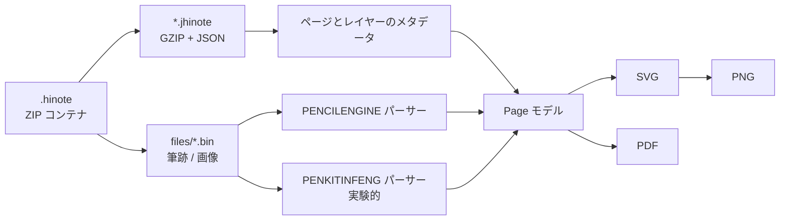

<div align="center">


<h1>Hinoter</h1>

<p>Huawei Notes の <code>.hinote</code> を読み書きする小さなツール。ブラウザでのプレビューと書き出しに対応しています。</p>

[](LICENSE)
[](#コマンドラインリファレンス)
[](#対応範囲)
[](https://github.com/huwangpeng/Hinoter/stargazers)
[](https://github.com/deepseek-ai/deepseek-harness)

[中文](README.md) | [English](README_EN.md) | 日本语

</div>

## これは何か

`.hinote` は Huawei Notes アプリの独自形式です。本プロジェクトはこれを可逆な SVG / PDF に変換し、Web ビューアと Python コマンドライン版の両方を提供します。

## 目次

- [クイックスタート](#クイックスタート)
- [コマンドラインリファレンス](#コマンドラインリファレンス)
- [レイヤー](#レイヤー)
- [対応範囲](#対応範囲)
- [解析フロー](#解析フロー)
- [プロジェクト構成](#プロジェクト構成)
- [ロードマップ](#ロードマップ)
- [ライセンス](#ライセンス)

## クイックスタート

| やりたいこと | 入口 | 追加で必要なもの |
| --- | --- | --- |
| ノートをプレビューして SVG / PDF / PNG に書き出す | [index.html](index.html) | なし |
| まとめて書き出す | [src/hinote_vector_export.py](src/hinote_vector_export.py) | Python 3.10 以上 |
| PNG に書き出す | 同じスクリプトに `--ppi` を付ける | `cairosvg` |
| PDF をノートに変換 | [src/pdf_to_hinote.py](src/pdf_to_hinote.py) | `pypdf` |

### 1. Web ビューア

リポジトリ直下の [index.html](index.html) を開き、ノートの種類に合わせてビューアを選びます。

- [web/hinote-viewer.html](web/hinote-viewer.html)：通常ノート（`PENCILENGINE`）
- [web/infinite-viewer.html](web/infinite-viewer.html)：無限キャンバス（`PENKITINFENG`）、実験的

### 2. コマンドラインでの書き出し

```powershell
python src/hinote_vector_export.py "笔记.hinote"
```

結果は `out/笔记/` に出力され、レポートは同じ場所の `report.md` にまとまります。

Hinoter は複数ファイルの一括処理にも対応しています。

```powershell
python src/hinote_vector_export.py "笔记一.hinote" "笔记二.hinote" -o export
```

### 3. PNG に書き出す

```powershell
pip install cairosvg
python src/hinote_vector_export.py "笔记.hinote" --ppi 300 --size a4
```

任意の依存関係：  
`fonttools` を入れると PDF に中国語テキストを埋め込めます（システムに中国語フォントが必要です）。  
`pymupdf` を入れると取り込んだ PDF の背景ページを復元できます。

```powershell
pip install fonttools pymupdf
```

### 4. PDF をノートに変換

[src/pdf_to_hinote.py](src/pdf_to_hinote.py) は PDF を `.hinote` コンテナに収めます。Huawei Notes で PDF を直接読み込んだときとほぼ同じ見え方になります。

```powershell
pip install pypdf
python src/pdf_to_hinote.py "资料.pdf" -o "导入用.hinote" --title "项目资料"
```

既定では PDF と同じディレクトリに同じ名前で `.hinote` を出力します。同名のファイルが既にある場合は停止し、上書きするには `--force` が必要です。

## コマンドラインリファレンス

| 引数 | 説明 | 既定値 |
| --- | --- | --- |
| `archives...` | 1 つ以上の `.hinote` ファイル | 必須 |
| `-o, --output` | 出力のルートディレクトリ | `out` |
| `--ppi` | PNG 出力の解像度（例：`300`） | `0`（PNG を書き出さない） |
| `--size` | 用紙：`a4` / `a3` / `a5` / `letter` / `legal`、または `幅x高さ` | `a4` |
| `--split-layers` | レイヤーごとに SVG を 1 枚ずつ `svg/layers/` にも出力 | オフ |
| `--only-layer` | 指定したレイヤーだけを出力（名前または id、複数指定可） | すべて |
| `--hide-layer` | 指定したレイヤーを除外（複数指定可） | なし |
| `--all-layers` | ノート側で非表示にしたレイヤーも出力 | 非表示はスキップ |
| `--outline` | 筆跡の輪郭アルゴリズム：`compact` は共線のカプセルを結合（既定・ファイルが小さい）、`classic` は 1 区間 1 カプセルのまま最適化前の出力とバイト単位で一致 | `compact` |

## レイヤー

Huawei Notes は `hinote_1.0.6` 以降でページレイヤーに対応しています。本ツールはこれを自動で判別し、レイヤー情報を `report.md` に書き出します。

```powershell
# 結合して出力（既定の動作：表示中のレイヤーを下から上へ合成）
python src/hinote_vector_export.py "多图层笔记.hinote"

# レイヤーごとに SVG を 1 枚ずつ svg/layers/ にも出力
python src/hinote_vector_export.py "多图层笔记.hinote" --split-layers

# レイヤー名または id で絞り込む
python src/hinote_vector_export.py "多图层笔记.hinote" --only-layer "图层 1"
python src/hinote_vector_export.py "多图层笔记.hinote" --hide-layer 0

# ノート側で非表示のレイヤーも出力
python src/hinote_vector_export.py "多图层笔记.hinote" --all-layers
```

`--hide-layer` / `--only-layer` はどちらもレイヤー名（大文字小文字を区別しません）または `layerId` に一致し、複数回指定できます。ノート側で非表示にされたレイヤーは既定でスキップされます。旧バージョンのノートにはレイヤー情報がないため、従来どおりに動作します。

筆跡がどのレイヤーに属するかは、各ストロークのスタイルレコード直前にある 16 バイトのレイヤー UUID で判定します。バイト単位の詳細と判定方法は [HINOTE_FORMAT.md](docs/HINOTE_FORMAT.md#多图层hinote_106) を参照してください。

## 対応範囲

| 内容 | 通常ノート `PENCILENGINE` | 無限キャンバス `PENKITINFENG` |
| --- | :---: | :---: |
| ペン / 蛍光ペン（可変幅・透過） | ✅ | ⚠️ 実験的 |
| テキスト・画像 | ✅ | ⚠️ 座標のみ |
| 罫線 / 方眼 / ドット方眼テンプレート | ✅ | ❌ |
| 読み込んだ PDF / 画像ページ | ✅ | ❌ |
| レイヤー（`hinote_1.0.6`） | ✅ | ❌ |
| 縦横ページの混在 | ✅ | ❌ |
| コマンドラインでの書き出し | ✅ | ❌ |

## 解析フロー



## プロジェクト構成

```text
hinoter/
├── index.html                      ビューアの入口
├── src/
│   ├── hinote_vector_export.py     通常ノートの書き出し（SVG / PDF / PNG）
│   ├── hinote_infinite.py          無限キャンバス解析の実験
│   └── pdf_to_hinote.py            PDF → 通常ノート
├── tests/
│   ├── test_layers.py              レイヤー解析・絞り込み・通しの書き出し
│   └── test_infinite.py            無限キャンバスの解析
├── web/
│   ├── hinote-viewer.html          通常ノートのビューア
│   └── infinite-viewer.html        無限キャンバスのビューア
├── docs/
│   ├── HINOTE_FORMAT.md            通常ノートの形式メモ
│   ├── 无界笔记格式分析.md           無限キャンバスの形式メモ
│   └── images/                     README 用スクリーンショット
└── sample/                         ローカルサンプル（未コミット）
```

## ロードマップ

- [x] 通常ノート：筆跡・テキスト・画像・テンプレート・レイヤー
- [x] コマンドラインで SVG / PDF / PNG に書き出す
- [x] PDF → `.hinote`
- [ ] `PENKITINFENG` の予約フィールドとペン幅の変化
- [ ] 無限キャンバスをメインの書き出しスクリプトに統合
- [ ] 書き戻し：筆跡付きの `.hinote` を生成

## ライセンス

MIT License です。詳細は [LICENSE](LICENSE) を参照してください。

## 謝辞

このプロジェクトが役に立ったら、スターを付けてもらえると嬉しいです。

[](https://star-history.com/#huwangpeng/Hinoter&Date)
